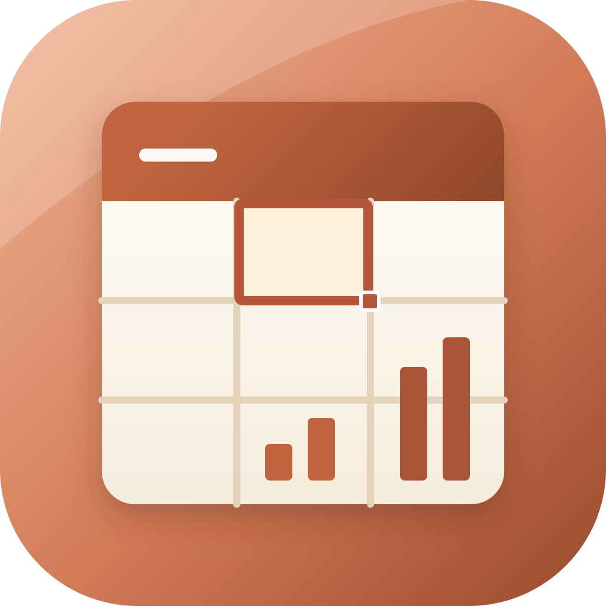
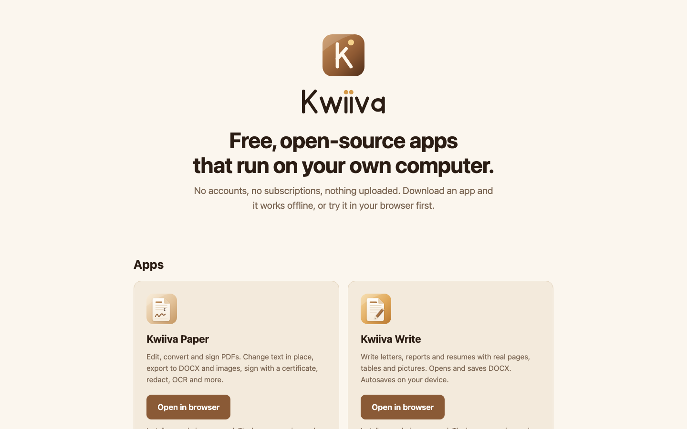
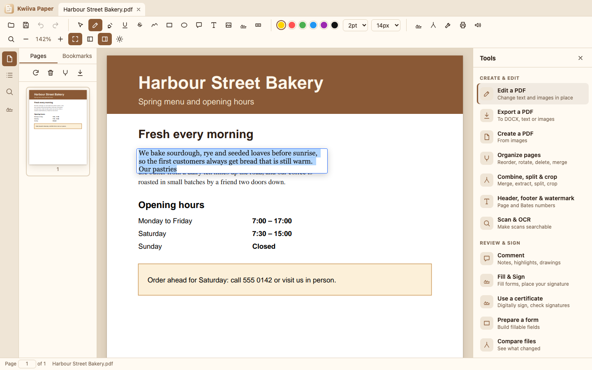
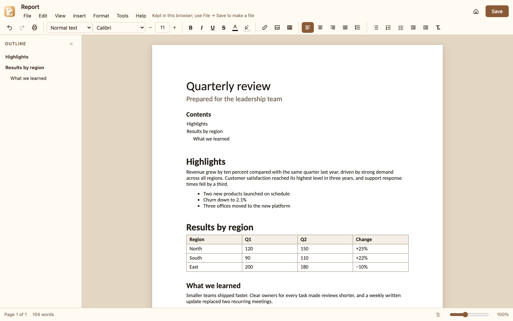
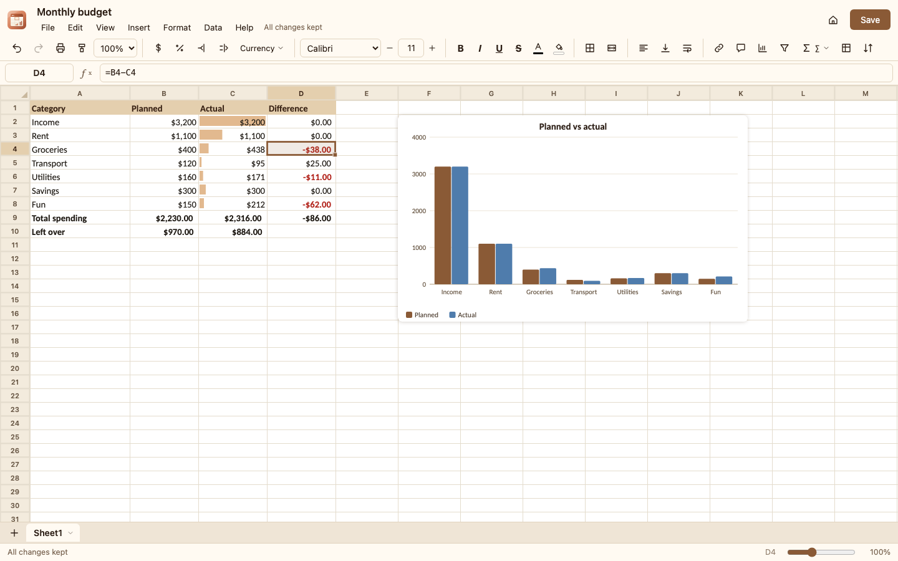
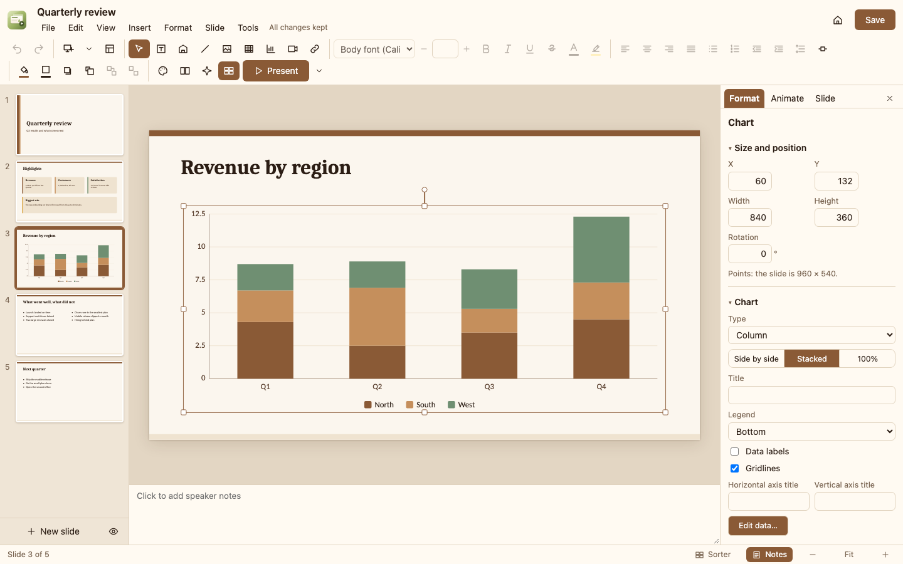
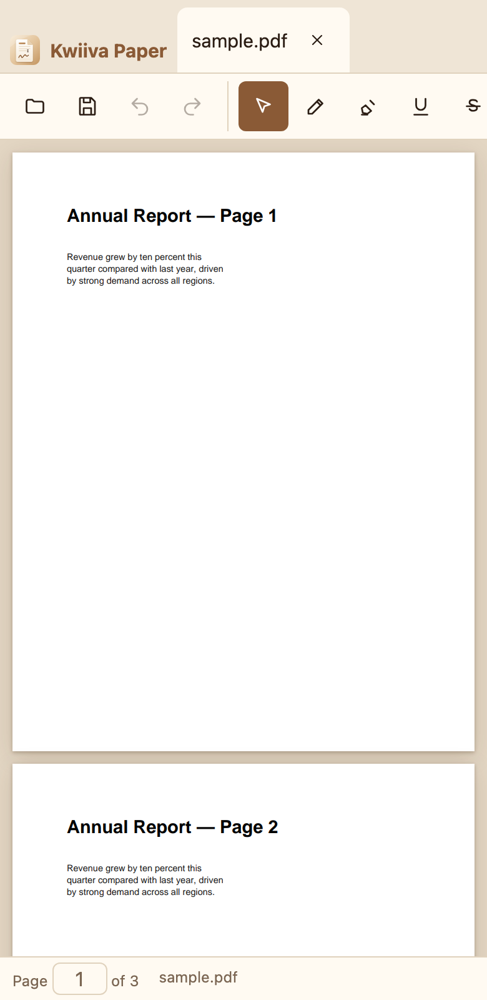
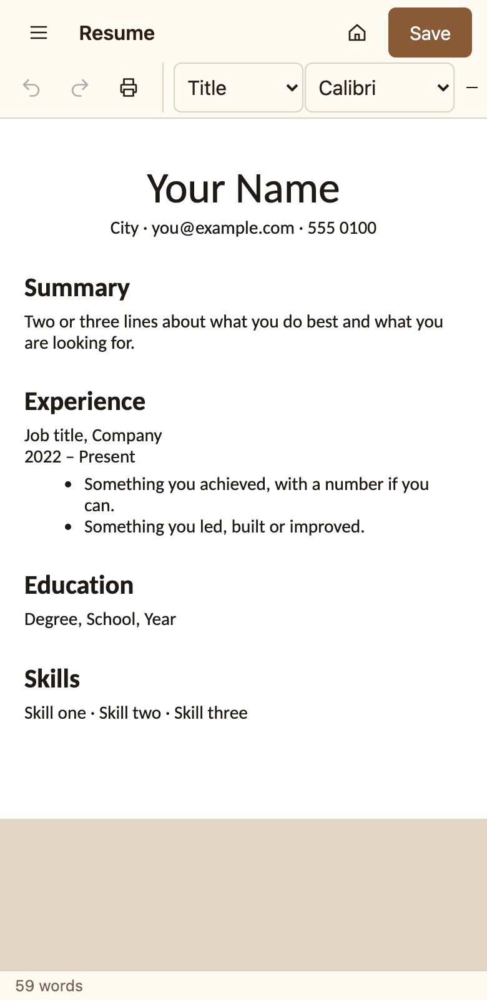
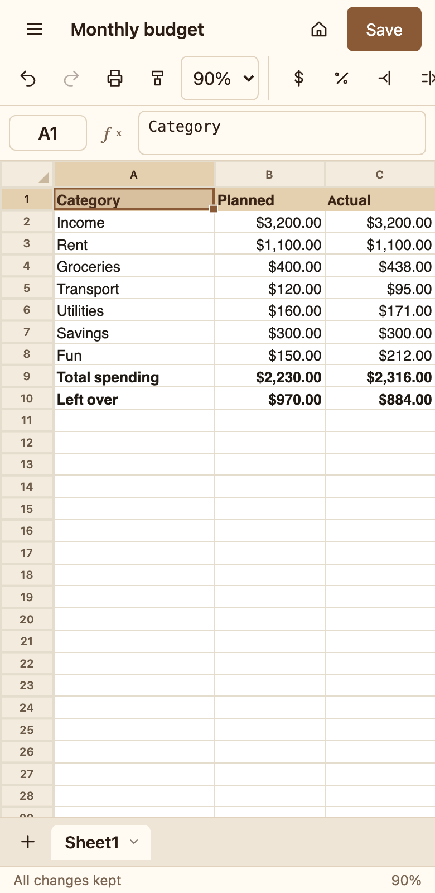
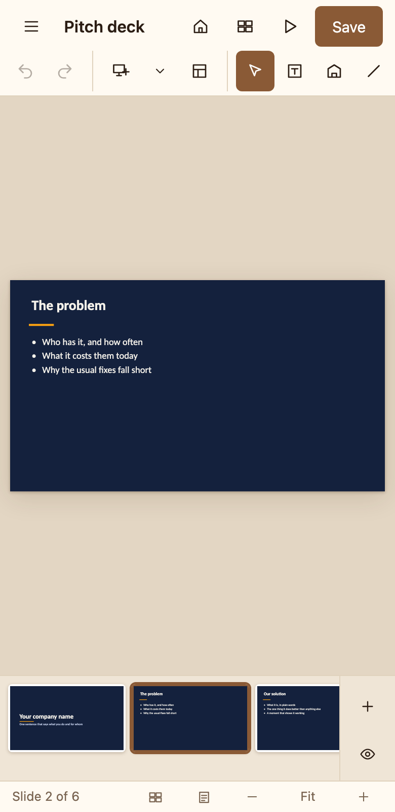

<p align="center"></p>

# Kwiiva

Free, open-source apps that run on your own computer. No accounts, no uploads, no subscriptions. This repository is the home of the Kwiiva website and every Kwiiva app.

| App | What it is | |
|---|---|---|
|  **Kwiiva Paper** | Edit, convert and sign PDFs | [details below](#kwiiva-paper) · web version at `/paper/app/` |
|  **Kwiiva Write** | Write documents, open and save DOCX | [details below](#kwiiva-write) · web version at `/write/app/` |
|  **Kwiiva Grid** | Spreadsheets: formulas, charts, pivot tables, XLSX | [details below](#kwiiva-grid) · web version at `/grid/app/` |
|  **Kwiiva Present** | Presentations: themes, charts, animations, PPTX | [details below](#kwiiva-present) · web version at `/present/app/` |

More apps will be added here.

<p align="center">
  <a href="https://kwiiva.netlify.app"></a>
</p>

<p align="center"><b>If Kwiiva is useful to you, please <a href="https://github.com/officialsasere/kwiiva">⭐ star the project</a>.</b> It is how other people find it.</p>

## Saving
Every app keeps your work in the browser or app as you type, so nothing is lost. Save a file once (Ctrl+S) to choose where it lives; after that **changes are written to that file automatically** a couple of seconds after you stop typing. Turn it off with **File → Save automatically** (the **Auto** button in Kwiiva Paper). In a browser that cannot keep a file open (Firefox, Safari) the first Save downloads a copy and automatic saving does not apply; use the desktop app for that.

## See it

| | |
|---|---|
| **Kwiiva Paper**: edit text in a PDF, convert and sign<br><a href="docs/screenshots/paper.png"></a> | **Kwiiva Write**: documents with real pages, tables and DOCX<br><a href="docs/screenshots/write.png"></a> |
| **Kwiiva Grid**: spreadsheets with 400+ functions, charts and pivot tables<br><a href="docs/screenshots/grid.png"></a> | **Kwiiva Present**: presentations with themes, charts and animations<br><a href="docs/screenshots/present.png"></a> |

**On a phone**: all four work in a mobile browser.

<p align="center">   </p>

_The pictures are made by `yarn screenshots`, so they always show the real apps._


---

<p align="center"></p>

# Kwiiva Paper

**Edit, convert and sign PDFs, free and open source,** on Windows, macOS, Linux and in the browser. No account, no upload, no subscription. Your files never leave your computer.

## What it does

| | |
|---|---|
| **View** | Fast rendering, continuous scroll, zoom, fit-width, thumbnails, bookmarks, clickable links, tabs, search, dark mode, password-protected files, print, read aloud |
| **Edit text** | Click a paragraph and type. Re-flows inside its box; substitutes a similar font when the original lacks a character |
| **Edit images** | Insert, move, resize, replace, delete |
| **Annotate** | Highlight, underline, strikethrough, freehand, rectangle, ellipse, sticky notes, free text |
| **Forms** | Fill text fields, checkboxes, radios, dropdowns; create new fields |
| **Sign** | Draw/type a visual signature; **certificate-based digital signatures** (.p12/.pfx); **validates signatures** in files you open (intact / changed after signing) |
| **PDF/A** | Convert to PDF/A-2b (embeds fonts, adds metadata and colour profile, removes forbidden features) and a preflight checker |
| **Accessibility** | Auto-tag (headings, paragraphs, figures with alt text), set title and language, accessibility checker |
| **Redact** | Permanently removes text/images under a box, or everything matching emails, phone/ID/card numbers or your own words |
| **Organize** | Reorder, rotate, delete, insert blank pages, merge, extract, split (ZIP), crop, flatten |
| **Stamp** | Page numbers, Bates numbers, dates, headers/footers, watermarks |
| **OCR** | Makes scanned pages searchable and editable (English, runs locally) |
| **Protect / clean** | AES-256 encryption with permissions, file-size optimization, remove metadata/scripts/attachments, edit properties |
| **Convert** | PDF → DOCX (text and headings), text, PNG; images → PDF |
| **Compare** | Paragraph-level text diff of two documents |
| **Undo/redo** | For every change |

## Honest limitations

Read these before trusting Kwiiva Paper with something important.

- **Text editing is paragraph-based.** PDFs store positioned glyphs, not paragraphs, so Kwiiva Paper reconstructs paragraphs by layout analysis. Mixed styles inside an edited paragraph (e.g. one bold word) take the style of the first run once the edit touches that line. Text can't flow across columns or pages. Rotated and vertical text are untested.
- **Digital signatures** are real (PKCS#7 detached), but trust is up to the recipient: a self-signed certificate shows as unverified in most PDF readers. Signing produces a *copy*; re-saving a signed file in any editor (including this one) invalidates the signature. Validation checks that the signed content and signature are intact; Kwiiva Paper has no trusted-root store, so it cannot tell you the signer's identity is certified. Only one signature per file can be added, and it can't be added incrementally to an already-signed file.
- **PDF/A-2b conversion is not certified.** It is Kwiiva Paper's own implementation, tested against its own checker but **not against the official veraPDF validator**. Colours in page content are not converted (DeviceCMYK pages need a CMYK intent), and unusual fonts (Type 3, exotic encodings) may still fail. Validate files that need guaranteed compliance with veraPDF.
- **Accessibility tagging is automatic and layout-based.** It assigns headings by font size and reading order by position; tables, lists and multi-column layouts are tagged as plain paragraphs. It has not been checked with PAC or Acrobat's checker.
- **Not implemented:** cloud signing services, PDF/X and print Preflight, XFA forms, 3D/multimedia, creating PDFs from Office documents, Excel/PowerPoint export, image-based layout in Word export.
- **OCR is English-only** for now, and the recognized text layer is only as good as the scan.
- Characters outside the bundled fonts (e.g. CJK) can't be *typed* into an edit; Kwiiva Paper refuses the edit instead of writing broken glyphs. Existing CJK text is preserved.
- Redaction removes whole text objects that touch the box, which can remove a little more text than the box covers. Always check the result.
- The installers are **not code-signed** yet (see below).

## Install

**One click:** open the website and press **Download**, or use a direct link:

| System | Download |
|---|---|
| Windows | [KwiivaPaper-Windows-Setup.exe](https://github.com/officialsasere/kwiiva/releases/download/paper-latest/KwiivaPaper-Windows-Setup.exe) · [.msi](https://github.com/officialsasere/kwiiva/releases/download/paper-latest/KwiivaPaper-Windows.msi) |
| macOS (Apple silicon) | [KwiivaPaper-macOS-AppleSilicon.dmg](https://github.com/officialsasere/kwiiva/releases/download/paper-latest/KwiivaPaper-macOS-AppleSilicon.dmg) |
| macOS (Intel) | [KwiivaPaper-macOS-Intel.dmg](https://github.com/officialsasere/kwiiva/releases/download/paper-latest/KwiivaPaper-macOS-Intel.dmg) |
| Linux | [KwiivaPaper-Linux.AppImage](https://github.com/officialsasere/kwiiva/releases/download/paper-latest/KwiivaPaper-Linux.AppImage) · [.deb](https://github.com/officialsasere/kwiiva/releases/download/paper-latest/KwiivaPaper-Linux.deb) |

Or use it in the browser, nothing to install: open the website and choose **Open in browser** (`/paper/app/`; on a phone too: open it in your mobile browser and choose **Add to Home Screen** to install it like an app).

Because signing certificates cost money, your OS will warn you the first time:

- **macOS**: right-click the app → **Open** → **Open**. If it says the app is damaged: `xattr -cr "/Applications/Kwiiva Paper.app"`.
- **Windows**: SmartScreen → **More info → Run anyway**.
- **Linux**: `chmod +x KwiivaPaper*.AppImage` and run it, or install the `.deb`.

## Kwiiva Write

<p align="center"></p>

**Write letters, reports, resumes and notes, free and open source,** on Windows, macOS, Linux, in the browser and on your phone. No account, nothing uploaded; drafts are kept on your device as you type.

| | |
|---|---|
| **Pages** | Real pages (Letter, A4, A5, Legal, A3) with margins, portrait or landscape, headers, footers and page numbers. Lines are never cut by a page break; headings stay with their text |
| **Text** | Fonts, sizes, bold, italic, underline, strikethrough, super/subscript, colours, highlights, styles (Title, Subtitle, Heading 1–6, Quote, Code), alignment, line and paragraph spacing, indents, tabs |
| **Structure** | Bulleted, numbered and check lists (nested), tables (merge, split, shade, resize), pictures (paste, drop, resize), links, horizontal lines, page breaks, a table of contents that updates itself, special characters |
| **Review** | Find and replace (match case, whole word), outline of headings, document statistics, read aloud, browser spell checking |
| **Files** | Open and save **.docx** (text, styles, lists, tables with merged cells, pictures, links, page setup, headers and footers), plus HTML, Markdown and plain text; print or save as PDF |
| **Safety net** | Autosaved drafts in your browser, a Recent list, start-from-a-template screen (letter, resume, report, meeting notes, project plan) |
| **Phones** | Layout adapts to small screens, a full-screen menu, finger-sized buttons; install it from the browser with **Add to Home Screen** |

### Honest limitations (Kwiiva Write)
- **No real-time collaboration, comments or tracked changes yet.** Documents live on your device; share them as files.
- **.docx fidelity is good for ordinary documents, not perfect.** Text boxes, shapes, columns, footnotes, equations and tracked changes in files you open are not kept. Always check an important file after opening it.
- **PDF export uses your system's print dialog** ("Save as PDF"). Page numbers in printed headers and footers rely on the browser supporting page margin boxes (Chrome and Edge do; Safari does not yet).
- **Layout can differ slightly from other editors** because the page is laid out by the browser. The bundled fonts have the same widths as common office fonts, so line breaks normally match.
- **Phones:** it runs in the mobile browser and installs to the home screen. There is no store app yet.

### Install (Kwiiva Write)

| System | Download |
|---|---|
| Windows | [KwiivaWrite-Windows-Setup.exe](https://github.com/officialsasere/kwiiva/releases/download/write-latest/KwiivaWrite-Windows-Setup.exe) · [.msi](https://github.com/officialsasere/kwiiva/releases/download/write-latest/KwiivaWrite-Windows.msi) |
| macOS (Apple silicon) | [KwiivaWrite-macOS-AppleSilicon.dmg](https://github.com/officialsasere/kwiiva/releases/download/write-latest/KwiivaWrite-macOS-AppleSilicon.dmg) |
| macOS (Intel) | [KwiivaWrite-macOS-Intel.dmg](https://github.com/officialsasere/kwiiva/releases/download/write-latest/KwiivaWrite-macOS-Intel.dmg) |
| Linux | [KwiivaWrite-Linux.AppImage](https://github.com/officialsasere/kwiiva/releases/download/write-latest/KwiivaWrite-Linux.AppImage) · [.deb](https://github.com/officialsasere/kwiiva/releases/download/write-latest/KwiivaWrite-Linux.deb) |

The same first-run warnings as Kwiiva Paper apply (the installers are not code-signed). Or use it in the browser at `/write/app/`.

## Kwiiva Grid

<p align="center"></p>

**Spreadsheets, free and open source,** on Windows, macOS, Linux, in the browser and on your phone. No account, nothing uploaded; your work is kept on your device as you go.

| | |
|---|---|
| **Formulas** | **409 functions** (maths, statistics and distributions, text, dates, lookup, finance, engineering, information, logic), operators and references like `$A$1`, `A:A`, `Sheet2!B3:C9` and `A1#`. **Dynamic arrays** that spill (`FILTER`, `SORT`, `SORTBY`, `UNIQUE`, `SEQUENCE`, `TRANSPOSE`, `VSTACK`, `TEXTSPLIT`…), `LET`, `LAMBDA`, `MAP`, `REDUCE`, `SCAN`, named ranges |
| **Cells** | Typing recognises numbers, percentages, currency, dates and times. Number formats (`#,##0.00`, `0%`, `yyyy-mm-dd`, `[h]:mm`, fractions, scientific, your own codes), fonts, colours, borders, merged cells, wrapping, rotation, indent, hyperlinks, notes |
| **Sheet** | Several sheets, freeze panes, hide and resize rows and columns, fit to data, insert and delete rows and columns (formulas follow), gridlines on/off, tab colours, protect a sheet |
| **Work fast** | Autofill series (numbers, dates, months, `Item 1, Item 2…`, formulas), copy and paste with formulas and formats, paste special, format painter, find and replace (with formulas and regular expressions), go to, undo and redo without limit |
| **Data** | Sort by several columns, filters with search and conditions, remove duplicates, trim spaces, split text to columns, data validation (lists, numbers, dates, custom, **check boxes**), pivot tables |
| **See it** | Conditional formatting (value, text, duplicates, top/bottom, dates, formulas, **colour scales**, **data bars**), charts (column, bar, line, area, pie, doughnut, scatter, stacked, 100%), pictures, `SPARKLINE` |
| **Files** | Open and save **.xlsx** (values, formulas, formats, merges, sizes, freeze panes, conditional formats, validation, links, names) plus **.csv** and **.tsv**; export HTML and JSON; print or save as PDF |
| **Phones** | Tap to select, double-tap to edit, finger scrolling, full-screen menu, install from the browser with **Add to Home Screen** |

### Honest limitations (Kwiiva Grid)
- **Charts, pictures and notes do not appear in other programs.** They are stored inside the .xlsx so Kwiiva Grid restores them, but other spreadsheet programs ignore them. Everything else in the table above travels.
- **No real-time collaboration, macros or external data connections** (no live stock prices, no importing from other files by formula).
- **Pivot tables are snapshots.** Make a new one when the data changes.
- **Not every function matches other programs to the last digit** (especially the statistical distributions, which are accurate to about 10 digits). Always check an important calculation.
- **A million rows work, but very large files are slower** than in desktop-class programs. Tens of thousands of formulas recalculate in well under a second.
- **Dates use the 1900 system** with its well-known leap-year quirk, so serial numbers match other programs.

### Install (Kwiiva Grid)

| System | Download |
|---|---|
| Windows | [KwiivaGrid-Windows-Setup.exe](https://github.com/officialsasere/kwiiva/releases/download/grid-latest/KwiivaGrid-Windows-Setup.exe) · [.msi](https://github.com/officialsasere/kwiiva/releases/download/grid-latest/KwiivaGrid-Windows.msi) |
| macOS (Apple silicon) | [KwiivaGrid-macOS-AppleSilicon.dmg](https://github.com/officialsasere/kwiiva/releases/download/grid-latest/KwiivaGrid-macOS-AppleSilicon.dmg) |
| macOS (Intel) | [KwiivaGrid-macOS-Intel.dmg](https://github.com/officialsasere/kwiiva/releases/download/grid-latest/KwiivaGrid-macOS-Intel.dmg) |
| Linux | [KwiivaGrid-Linux.AppImage](https://github.com/officialsasere/kwiiva/releases/download/grid-latest/KwiivaGrid-Linux.AppImage) · [.deb](https://github.com/officialsasere/kwiiva/releases/download/grid-latest/KwiivaGrid-Linux.deb) |

The same first-run warnings as the other apps apply (the installers are not code-signed). Or use it in the browser at `/grid/app/`.

## Kwiiva Present

<p align="center"></p>

**Presentations, free and open source,** on Windows, macOS, Linux, in the browser and on your phone. No account, nothing uploaded; your work is kept on your device as you go.

| | |
|---|---|
| **Slides** | Ten themes with eight layouts each (title, content, two columns, comparison, section, picture with caption…). Change the theme and every slide is recoloured; edit the **slide master** or a layout once and it applies everywhere. Slide sorter, sections, hidden slides, slide numbers, dates and footers, five slide sizes or your own |
| **Text** | Real text editing in place: fonts, sizes, bold, italic, underline, colours, highlights, super- and subscript, links, bullets and numbering (five styles, any level), alignment, line and paragraph spacing, columns, shrink-to-fit |
| **Objects** | Nearly 90 shapes (arrows, callouts, flowchart symbols, stars, brackets…) with an adjust handle each, lines and elbow or curved connectors with arrowheads, pictures (crop to a shape, borders, shadows), **tables** (merged cells, banded rows, resize by dragging), **charts** (column, bar, line, area, pie, doughnut, scatter, radar; edit the data like a small sheet), audio and video, groups |
| **Arrange** | Move, resize and rotate with handles; smart guides that snap to other objects and the slide centre; align, distribute, order, group, flip, lock; arrow-key nudging; grid and centre guides; copy, paste, duplicate (Ctrl-drag) |
| **Animate** | Entrance, emphasis and exit effects (appear, fade, fly, wipe, zoom, float, split, blinds, grow, spin, pulse, teeter…), on click / with previous / after previous, with duration and delay, paragraph by paragraph; slide transitions (fade, push, wipe, cover, zoom, flip, cube, dissolve, morph…) and automatic timings |
| **Present** | Full screen, keyboard, mouse and swipe navigation, jump to any slide, pen, highlighter, eraser and **laser pointer**, black and white screens, an all-slides view, and a **presenter view** with notes, the next slide and a timer, plus a second **audience window** for a projector |
| **Files** | Open and save **.pptx**; export **PDF**, **PNG pictures** (all slides in a .zip), a **single web page** that plays the show anywhere, or a plain **outline**; make slides from an outline in Markdown; print |
| **Phones** | Tap to select, drag to move, a slide strip, a bottom sheet for formatting, swipe through the show, and **Add to Home Screen** |

### Honest limitations (Kwiiva Present)
- **A .pptx made by Kwiiva Present reopens exactly in Kwiiva Present** (a copy of the deck is kept inside the file). If another program has edited the file since, Kwiiva Present reads the standard parts instead: text, shapes, pictures, tables, charts, notes, transitions and animations are read, but some things are not.
- **Not supported when opening other files:** SmartArt that has no saved picture, equations, 3D models, ink drawings, embedded objects, WordArt effects and custom table styles (tables are drawn in a similar look). Comments are not read. The program says so when it leaves something out.
- **Videos and audio are kept in Kwiiva Present but are not written into .pptx files.** They are included in the web page export.
- **Some transitions are simpler in other programs**: flip, cube and morph are saved as a fade in .pptx.
- **The PDF is made from pictures of each slide** (text cannot be selected). For a PDF with selectable text use Print → Save as PDF.
- **No real-time collaboration, comments or version history.** Share the file instead.
- **No text effects** such as reflection or 3D, and no equation editor.
- **Fonts**: slides keep the font names you chose. If a font is not installed on a device, a similar built-in one is used (Carlito, Caladea and Liberation are built in), so line breaks can differ a little.

### Install (Kwiiva Present)

| System | Download |
|---|---|
| Windows | [KwiivaPresent-Windows-Setup.exe](https://github.com/officialsasere/kwiiva/releases/download/present-latest/KwiivaPresent-Windows-Setup.exe) · [.msi](https://github.com/officialsasere/kwiiva/releases/download/present-latest/KwiivaPresent-Windows.msi) |
| macOS (Apple silicon) | [KwiivaPresent-macOS-AppleSilicon.dmg](https://github.com/officialsasere/kwiiva/releases/download/present-latest/KwiivaPresent-macOS-AppleSilicon.dmg) |
| macOS (Intel) | [KwiivaPresent-macOS-Intel.dmg](https://github.com/officialsasere/kwiiva/releases/download/present-latest/KwiivaPresent-macOS-Intel.dmg) |
| Linux | [KwiivaPresent-Linux.AppImage](https://github.com/officialsasere/kwiiva/releases/download/present-latest/KwiivaPresent-Linux.AppImage) · [.deb](https://github.com/officialsasere/kwiiva/releases/download/present-latest/KwiivaPresent-Linux.deb) |

The same first-run warnings as the other apps apply (the installers are not code-signed). Or use it in the browser at `/present/app/`.

## Privacy

Your documents, spreadsheets, presentations and PDFs never leave your device, and nothing in them is read by anyone but you. There are no accounts and no tracking of what you do inside the apps.

The website shows how much Kwiiva is used. To make that possible:
- **Downloads** from the website go through a tiny counter (`netlify/functions/stats.mts`) that adds one to a total and sends you on to GitHub.
- **Launches:** each app sends one small message when it opens: the app name, "web" or "desktop", and whether this is its first launch on this device. There is no ID, no file name, no text, and the server does not store your address. The result is three public numbers per app: downloads, launches and devices (first launches).
- **You can turn it off** in the app (Kwiiva Write: Help → Privacy and counters; Kwiiva Paper: the start screen). The apps work the same either way.
- Developers running the app locally and automated tests are not counted. Because anyone could send fake messages, treat the numbers as approximate.

## Contributing

Kwiiva is open source and made to be easy to join: read [CONTRIBUTING.md](CONTRIBUTING.md) (set up in 10 minutes, `yarn verify` before a pull request), pick an issue labelled **good first issue**, or just report a PDF that comes out wrong. Everyone is welcome under our [Code of Conduct](CODE_OF_CONDUCT.md). See the [changelog](CHANGELOG.md) for what changed.

## Build from source

```bash
git clone https://github.com/officialsasere/kwiiva && cd kwiiva
yarn install
yarn dev            # web app
yarn tauri dev      # desktop app (needs Rust + Tauri prerequisites)
yarn tauri build    # installers for your OS
```

Tests: `yarn test` (engine), `yarn test:e2e` (browser). See [CONTRIBUTING.md](CONTRIBUTING.md).

## How it works

```
React UI  ──postMessage──▶  Web Worker
                              ├─ PDFium (WebAssembly)  rendering, text objects, annotations, pages
                              ├─ pdf-lib               form fields
                              ├─ qpdf (WebAssembly)    encryption, optimization
                              └─ Tesseract (via main)  OCR → invisible text layer
Tauri (Rust) wraps the same UI for desktop: native dialogs, file associations.
```

Text editing works on PDFium's page objects: group text runs into lines and paragraphs → edit in an overlay → re-wrap with measured glyph widths → write new text objects (original font if it can draw the text, otherwise an embedded Liberation/DejaVu face) → remove the old objects. Only the edited lines are rewritten, so the rest of the page is untouched. Every document change snapshots the file first, which is what makes undo exact.

## Hosting & releases (maintainers)

- **Website and web app: Netlify.** Connect the GitHub repo in Netlify (Add new site → Import from Git). `netlify.toml` already sets the build command (`yarn build`), publish folder (`dist`) and Node version; no other settings are needed. The Kwiiva home page is served at `/`, the Kwiiva Paper page at `/paper/` and the editor at `/paper/app/`. Every push to `main` redeploys.
- **Installers: GitHub Releases.** Actions → **Release** → **Run workflow** (or push a tag like `v0.1.0`) builds macOS (Apple silicon + Intel), Windows and Linux installers and publishes them under fixed names, so the website's Download button links straight to them.
- CI (`.github/workflows/ci.yml`) runs the type check, lint, unit tests and browser tests on every push and pull request.
- Package managers (Homebrew tap, winget, Flathub) are free; see [docs/PACKAGING.md](docs/PACKAGING.md).

## License

MIT. See [LICENSE](LICENSE) and [THIRD_PARTY_NOTICES.md](THIRD_PARTY_NOTICES.md).
