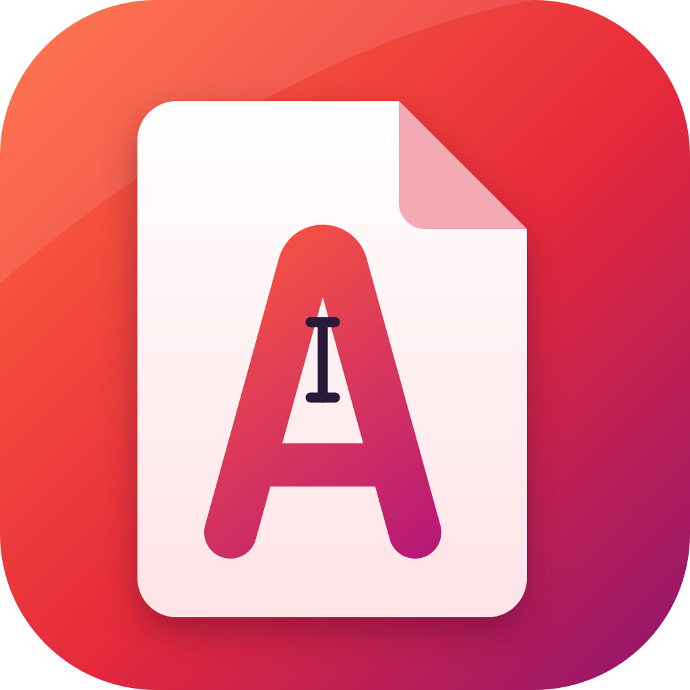

<p align="center"></p>

# Acrohat

**Edit, convert and sign PDFs, free and open source,** on Windows, macOS, Linux and in the browser. No account, no upload, no subscription. Your files never leave your computer.

## What it does

| | |
|---|---|
| **View** | Fast rendering, continuous scroll, zoom, fit-width, thumbnails, bookmarks, clickable links, tabs, search, dark mode, password-protected files, print, read aloud |
| **Edit text** | Click a paragraph and type. Re-flows inside its box; substitutes a similar font when the original lacks a character |
| **Edit images** | Insert, move, resize, replace, delete |
| **Annotate** | Highlight, underline, strikethrough, freehand, rectangle, ellipse, sticky notes, free text |
| **Forms** | Fill text fields, checkboxes, radios, dropdowns; create new fields |
| **Sign** | Draw/type a visual signature; **certificate-based digital signatures** (.p12/.pfx); **validates signatures** in files you open (intact / changed after signing) |
| **PDF/A** | Convert to PDF/A-2b (embeds fonts, adds metadata and colour profile, removes forbidden features) and a preflight checker |
| **Accessibility** | Auto-tag (headings, paragraphs, figures with alt text), set title and language, accessibility checker |
| **Redact** | Permanently removes text/images under a box, or everything matching emails, phone/ID/card numbers or your own words |
| **Organize** | Reorder, rotate, delete, insert blank pages, merge, extract, split (ZIP), crop, flatten |
| **Stamp** | Page numbers, Bates numbers, dates, headers/footers, watermarks |
| **OCR** | Makes scanned pages searchable and editable (English, runs locally) |
| **Protect / clean** | AES-256 encryption with permissions, file-size optimization, remove metadata/scripts/attachments, edit properties |
| **Convert** | PDF → Word (.docx, text and headings), text, PNG; images → PDF |
| **Compare** | Paragraph-level text diff of two documents |
| **Undo/redo** | For every change |

## Honest limitations

Read these before trusting Acrohat with something important.

- **Text editing is paragraph-based.** PDFs store positioned glyphs, not paragraphs, so Acrohat reconstructs paragraphs by layout analysis. Mixed styles inside an edited paragraph (e.g. one bold word) take the style of the first run once the edit touches that line. Text can't flow across columns or pages. Rotated and vertical text are untested.
- **Digital signatures** are real (PKCS#7 detached), but trust is up to the recipient: a self-signed certificate shows as unverified in Acrobat. Signing produces a *copy*; re-saving a signed file in any editor (including this one) invalidates the signature. Validation checks that the signed content and signature are intact; Acrohat has no trusted-root store, so it cannot tell you the signer's identity is certified. Only one signature per file can be added, and it can't be added incrementally to an already-signed file.
- **PDF/A-2b conversion is not certified.** It is Acrohat's own implementation, tested against its own checker but **not against the official veraPDF validator**. Colours in page content are not converted (DeviceCMYK pages need a CMYK intent), and unusual fonts (Type 3, exotic encodings) may still fail. Validate files that need guaranteed compliance with veraPDF.
- **Accessibility tagging is automatic and layout-based.** It assigns headings by font size and reading order by position; tables, lists and multi-column layouts are tagged as plain paragraphs. It has not been checked with PAC or Acrobat's checker.
- **Not implemented:** Adobe Sign / cloud services, PDF/X and print Preflight, XFA forms, 3D/multimedia, creating PDFs from Office documents, Excel/PowerPoint export, image-based layout in Word export.
- **OCR is English-only** for now, and the recognized text layer is only as good as the scan.
- Characters outside the bundled fonts (e.g. CJK) can't be *typed* into an edit; Acrohat refuses the edit instead of writing broken glyphs. Existing CJK text is preserved.
- Redaction removes whole text objects that touch the box, which can remove a little more text than the box covers. Always check the result.
- The installers are **not code-signed** yet (see below).

## Install

**One click:** open the website and press **Download**, or use a direct link:

| System | Download |
|---|---|
| Windows | [Acrohat-Windows-Setup.exe](https://github.com/officialsasere/acrohat/releases/latest/download/Acrohat-Windows-Setup.exe) · [.msi](https://github.com/officialsasere/acrohat/releases/latest/download/Acrohat-Windows.msi) |
| macOS (Apple silicon) | [Acrohat-macOS-AppleSilicon.dmg](https://github.com/officialsasere/acrohat/releases/latest/download/Acrohat-macOS-AppleSilicon.dmg) |
| macOS (Intel) | [Acrohat-macOS-Intel.dmg](https://github.com/officialsasere/acrohat/releases/latest/download/Acrohat-macOS-Intel.dmg) |
| Linux | [Acrohat-Linux.AppImage](https://github.com/officialsasere/acrohat/releases/latest/download/Acrohat-Linux.AppImage) · [.deb](https://github.com/officialsasere/acrohat/releases/latest/download/Acrohat-Linux.deb) |

Or use it in the browser, nothing to install: open the website and choose **Open in browser** (`/app/`).

Because signing certificates cost money, your OS will warn you the first time:

- **macOS**: right-click the app → **Open** → **Open**. If it says the app is damaged: `xattr -cr /Applications/Acrohat.app`.
- **Windows**: SmartScreen → **More info → Run anyway**.
- **Linux**: `chmod +x Acrohat*.AppImage` and run it, or install the `.deb`.

## Build from source

```bash
git clone https://github.com/officialsasere/acrohat && cd acrohat
npm install
npm run dev            # web app
npm run tauri dev      # desktop app (needs Rust + Tauri prerequisites)
npm run tauri build    # installers for your OS
```

Tests: `npm test` (engine), `npm run test:e2e` (browser). See [CONTRIBUTING.md](CONTRIBUTING.md).

## How it works

```
React UI  ──postMessage──▶  Web Worker
                              ├─ PDFium (WebAssembly)  rendering, text objects, annotations, pages
                              ├─ pdf-lib               form fields
                              ├─ qpdf (WebAssembly)    encryption, optimization
                              └─ Tesseract (via main)  OCR → invisible text layer
Tauri (Rust) wraps the same UI for desktop: native dialogs, file associations.
```

Text editing works on PDFium's page objects: group text runs into lines and paragraphs → edit in an overlay → re-wrap with measured glyph widths → write new text objects (original font if it can draw the text, otherwise an embedded Liberation/DejaVu face) → remove the old objects. Only the edited lines are rewritten, so the rest of the page is untouched. Every document change snapshots the file first, which is what makes undo exact.

## Hosting & releases (maintainers)

- **Website and web app: Netlify.** Connect the GitHub repo in Netlify (Add new site → Import from Git). `netlify.toml` already sets the build command (`npm run build`), publish folder (`dist`) and Node version; no other settings are needed. The landing page is served at `/` and the editor at `/app/`. Every push to `main` redeploys.
- **Installers: GitHub Releases.** Actions → **Release** → **Run workflow** (or push a tag like `v0.1.0`) builds macOS (Apple silicon + Intel), Windows and Linux installers and publishes them under fixed names, so the website's Download button links straight to them.
- CI (`.github/workflows/ci.yml`) runs the type check, lint, unit tests and browser tests on every push and pull request.
- Package managers (Homebrew tap, winget, Flathub) are free; see [docs/PACKAGING.md](docs/PACKAGING.md).

## License

MIT. See [LICENSE](LICENSE) and [THIRD_PARTY_NOTICES.md](THIRD_PARTY_NOTICES.md).
